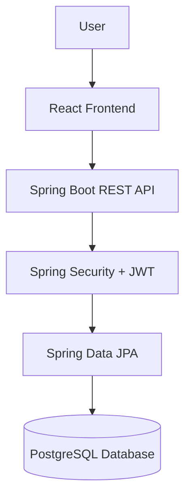

```md
# Comfortable Diet Planner

A full-stack diet planning and nutrition management system designed to help users track dietary habits, receive personalized food recommendations, and manage nutrition goals with a modern web interface and secure backend API.

This project combines a React + TypeScript frontend with a Java Spring Boot backend, making it suitable for portfolio, academic, and practical application scenarios in health-tech and wellness platforms.

## Overview

The Comfortable Diet Planner is aimed at helping users improve their eating habits through:

- Personalized diet suggestions
- Nutrition-aware meal planning
- User authentication and profile management
- Data-driven health and nutrition tracking
- A clean, responsive web interface

The system is designed to support both a practical clinical wellness workflow and a scalable digital nutrition platform.

## Key Features

- User registration and authentication
- Personalized diet recommendations
- Nutrition and meal tracking
- Modern dashboard interface
- Secure API layer using JWT
- Role-based backend security structure
- PostgreSQL database integration
- Responsive frontend for desktop and mobile screens
- Spring Boot backend architecture
- Easy local development setup

## Tech Stack

### Frontend
- React
- TypeScript
- Vite
- React Router
- Tailwind CSS
- Recharts
- Axios
- Lucide React

### Backend
- Java 21
- Spring Boot 3
- Spring Web
- Spring Data JPA
- Spring Security
- PostgreSQL
- Maven
- JWT authentication

### Database
- PostgreSQL

---

## Project Structure

```text
Comfortable-Diet-Planner/
├── .gitignore
├── eslint.config.js
├── index.html
├── package.json
├── package-lock.json
├── postcss.config.js
├── tailwind.config.js
├── tsconfig.json
├── tsconfig.app.json
├── tsconfig.node.json
├── vite.config.ts
├── src/
│   ├── App.tsx
│   ├── index.css
│   ├── main.tsx
│   ├── types.ts
│   ├── vite-env.d.ts
│   ├── components/
│   └── utils/
├── backend/
│   ├── Dockerfile
│   ├── pom.xml
│   └── src/
│       └── main/
│           ├── java/
│           └── resources/
```

---

## Architecture

The application follows a standard full-stack web architecture:



This separation allows for cleaner development, maintainable APIs, and flexible deployment across frontend/backend services.

---

## Prerequisites

Before running this project, make sure you have:

- Node.js 18+
- npm
- Java 21
- Maven
- PostgreSQL

Optional:
- Docker
- pgAdmin or another PostgreSQL client

---

## Frontend Setup

From the project root:

```bash
npm install
npm run dev
```

The frontend will typically run at:

```text
http://localhost:5173
```

### Frontend Scripts

```bash
npm run dev     # start development server
npm run build   # production build
npm run lint    # linting
npm run preview # preview production build
```

---

## Backend Setup

From the backend directory:

```bash
cd backend
mvn clean install
mvn spring-boot:run
```

The backend will usually run at:

```text
http://localhost:8080
```

---

## Database Configuration

The backend is designed to use PostgreSQL. Configure the datasource in the Spring Boot application properties file inside the backend resources folder.

Example:

```properties
spring.datasource.url=jdbc:postgresql://localhost:5432/dietplanner_db
spring.datasource.username=postgres
spring.datasource.password=your_password
spring.jpa.hibernate.ddl-auto=update
spring.jpa.properties.hibernate.dialect=org.hibernate.dialect.PostgreSQLDialect
```

If you are using environment variables, you can also configure them through your local setup or deployment platform.

---

## Running the Application

To run the full application:

1. Start PostgreSQL
2. Start the backend
3. Start the frontend

Example:

```bash
cd backend
mvn spring-boot:run
```

Then in another terminal:

```bash
npm install
npm run dev
```

---

## Features in Detail

### User Experience
- Intuitive dashboard interface
- Structured meal and nutrition views
- Profile-based personalization
- Responsive design for everyday usage

### Backend Capabilities
- Security configuration with Spring Security
- JWT-based request authentication
- Structured REST API architecture
- Database persistence using JPA
- Extensible service-based design

---

## API Design

The backend uses a RESTful Spring Boot architecture. It is structured to support modular services for:

- Authentication
- User management
- Nutrition data
- Meal plans
- Diet recommendations
- Health tracking

This makes it easy to extend with more endpoints as the project grows.

---

## Development Notes

The frontend uses a Vite-based TypeScript setup, while the backend follows the standard Spring Boot Maven project layout. This combination supports fast development, easier debugging, and a clean separation between presentation and business logic.

---

## Docker Support

The project includes a Dockerfile in the backend directory for containerized deployment.

Example:

```bash
cd backend
docker build -t comfortable-diet-planner .
docker run -p 8080:8080 comfortable-diet-planner
```

---

## Deployment Recommendations

This project is suitable for deployment in:
- local development environments
- Docker containers
- cloud-hosted Spring Boot servers
- static hosting for the React frontend
- managed PostgreSQL services

A common deployment pattern is:
- Frontend: Vite static build or Node host
- Backend: Spring Boot application on a server or container platform
- Database: PostgreSQL service

---

## License

This repository does not currently appear to include a license file. If you plan to distribute or publish the project publicly, consider adding an open-source license such as MIT or Apache 2.0 before release.

---

## Future Extensions

This project can be extended with:

- AI-based meal recommendations
- BMI and calorie tracking
- Water intake logging
- Food image recognition
- Grocery list generation
- Fitness and health goal integration
- Admin analytics dashboard
- Appointment or nutritionist consultation flow

---

## Summary

The Comfortable Diet Planner is a modern, full-stack health and nutrition application built using a React frontend and Java Spring Boot backend. It demonstrates a practical architecture for a digital diet planning platform and is well suited for academic, portfolio, or real-world application development.

## Contact

For project-related questions or collaboration, contact the repository owner via GitHub:
- https://github.com/MohamedJaseen
olders
